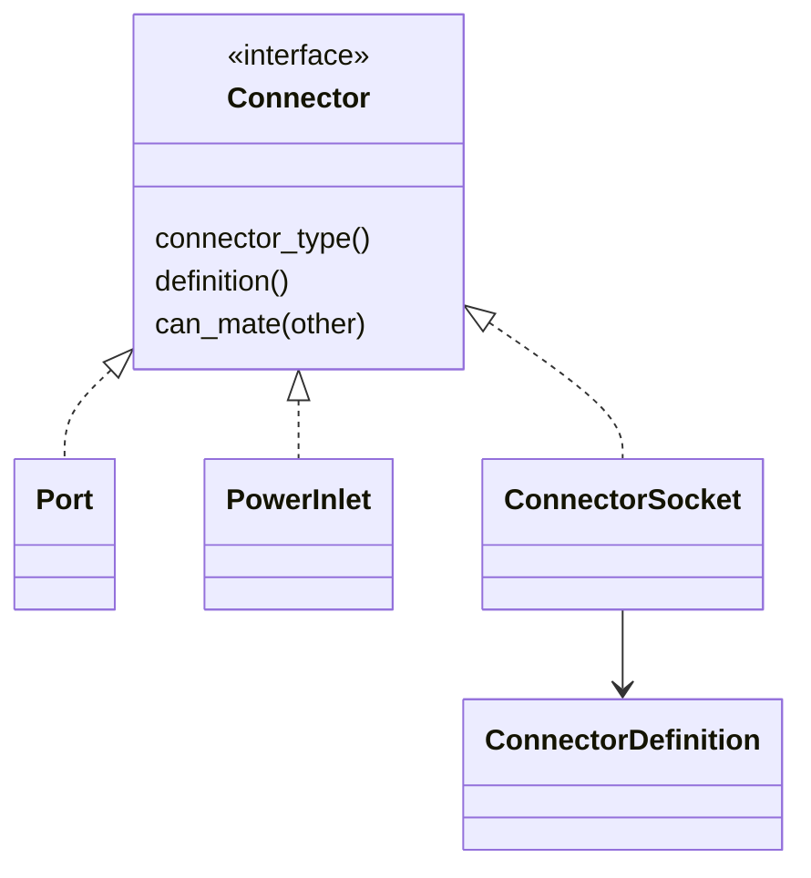

# Physical connectors

## Common interface

`sim::Connector` is the common parent interface for network and power connectors.
It exposes `connector_type()`, the JSON `definition()`, and physical `can_mate()`.
`Port`, `PortConnector`, `PowerInlet`, `PowerInletConnector`, `ConnectorType` and
resolved `ConnectorSocket` values implement that interface. Power outlets use
`ConnectorSocket` with the C13 connector definition.



Rust uses traits and composition for the shared object interface. Existing
network and power enums remain adapters so saved games retain their serialized
values and endpoint IDs. Network forwarding, module installation and power
calculations continue to use their existing authoritative subsystems.

## JSON configuration

`assets/equipment/connectors.json` defines connector identity, family, role,
physical mating pairs, default dimensions for legacy dynamic ports, and the
list of equipment socket maps. Its `atlases` and `sprites` sections define image
paths, sprite UV crops and cable exit positions for RJ45, optical and power
connector artwork. Catalogs load installed assets at startup, with
embedded defaults when a bundled asset is absent. Restart after editing assets.

Each equipment map has `type`, optional hardware-catalog `model`, texture paths,
`texture_uvs` per face, and a `ports` object grouped by connector key:

```json
{
  "type": "switch",
  "model": "c1000_24t_4x_l",
  "texture": "equipment/switch_4x_front.jpg",
  "texture_uvs": {"front": [0.016, 0.5075, 0.99, 0.6275]},
  "ports": {
    "sfp": [{
      "index": 24,
      "left_down": [0.8213552, 0.6041667],
      "right_up": [0.8542095, 0.8958333],
      "side": "front",
      "speed": "10G"
    }]
  }
}
```

Coordinates run from left/top to right/bottom within the cropped equipment
face. Network `index` is the global device port index; power `index` is the
inlet/outlet index. Patch panels therefore use even indices on the rear and
odd indices on the front. Explicit indices preserve identity when rectangles
are reordered. Legacy maps without indices use their order within a connector group and face;
switch uplink offsets and paired patch-panel indices are adapted from device metadata.

Servers resolve their model in `servers.json`: onboard sockets and power inlets
carry their connector key, face (`side`) and rectangle. PCIe cards in `server_parts.json`
carry `socket_rects`, local rectangles within the chassis slot's `face_rect`.
Those rectangles transform into the same `ConnectorSocket` used by other
hardware. Old external server/card configurations can omit the new fields and
retain default connector types and automatically spaced NIC sockets.

## One geometry path

`DeviceKind::connector_socket(&dyn Connector, side, index)` returns the shared
socket object. Its rectangle defines the image click area and socket artwork;
its center defines cable endpoints and the simulation's cable-length estimate.
`DeviceKind::power_inlet()` and `port_position_normalized()` delegate to this
resolver for older callers. The UI has no per-equipment socket dimensions or
image crops. Unmapped virtual network interfaces have no physical click area.

The texture mapper reads and writes the same `EquipmentSocketConfig` and
`SocketMapping` types. It offers all catalog connector types, supports explicit
socket indices, preserves other model metadata, and validates mappings before
saving. Unknown connector keys, invalid rectangles/faces/crops and duplicate
indices on the same connector group and face are rejected.

Physical mating rules do not replace electrical or optical checks. SFP module
capabilities, LC fiber profiles and power-cord rules stay in their respective
simulation subsystems and existing JSON catalogs. A new equipment/socket map
using an existing connector type needs JSON and artwork; a new connector family
also needs its transport behavior implemented in Rust.
